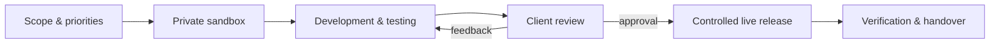

  
  <h1>Ellen Rensenbrink · SiteGuardly</h1>
  
<strong>Web development, integrations, technical SEO and website security from the Netherlands.</strong>

  

    <a href="https://siteguardly.com">Website</a> ·
    <a href="https://github.com/SiteGuardly?tab=repositories">Repositories</a> ·
    <a href="https://siteguardly.github.io">Technical portfolio</a>
  

## About

I am a Netherlands-based web developer with more than 15 years of experience in web design and development. I grew alongside the development of modern content management systems and now work across custom WordPress and WooCommerce solutions, Shopify, PHP, JavaScript, Python, API integrations, technical SEO and website security.

Together with my partner I run **SiteGuardly**, where we combine development, security, monitoring and practical communication into one controlled delivery process. I work in Dutch and English.

## What I build

| Area | Experience |
| --- | --- |
| WordPress & WooCommerce | Custom plugins and themes, complex data models, imports, subscriptions, dashboards and safe maintenance |
| Integrations | REST APIs, OAuth, webhooks, CRM, payment, accounting, CMS and marketplace connections |
| Python applications | Dashboards, data pipelines, background jobs, automation, local-first tooling and API clients |
| Technical SEO | Crawlability, structured data, performance, content architecture, tracking and measurable remediation |
| Security & reliability | Malware investigation, hardening, audit trails, least-privilege design, backups and controlled releases |
| Frontend & UX | Responsive interfaces, accessibility, clear information hierarchy and maintainable design systems |

## How SiteGuardly works

- **Private sandbox:** changes are built and tested away from the live website whenever the platform allows it.
- **Transparent planning:** work is organised on a shared Trello board where the client can follow progress, comment and approve items.
- **Clear communication:** written updates remain easy to review; email, Teams or Zoom can be used when a conversation is more effective.
- **Custom engineering:** I prefer cohesive, maintainable solutions over stacking unrelated plugins that introduce conflicts or unnecessary risk.
- **Safe publication:** this GitHub profile contains portfolio material and deliberately sanitised demonstrations. Customer data, credentials and proprietary production code remain private.

## Selected work

### [SiteGuardly platform](https://github.com/SiteGuardly/siteguardly-platform-case-study)

A custom WordPress platform for website security, technical SEO, quality monitoring, reporting and controlled integrations.

### [ETF AI Bot](https://github.com/SiteGuardly/etf-ai-bot-case-study)

A private Python research and automation platform with defensive execution boundaries, data-quality controls and a responsive operator dashboard.

### [Smart Home Operations Dashboard](https://github.com/SiteGuardly/smart-home-dashboard-case-study)

A local-first Python dashboard combining energy, lighting, audio, network and household services through resilient integrations.

### [WordPress Workflow Adapter Demo](https://github.com/SiteGuardly/wordpress-workflow-adapter-demo)

A safe public code sample demonstrating centralised state changes, CSV validation, webhook reuse, audit logging and automated tests.

## Engineering principles

1. Make important behaviour explicit and testable.
2. Keep third-party services behind adapters.
3. Validate input at every trust boundary.
4. Design background work to be retry-safe.
5. Preserve an audit trail for consequential changes.
6. Release only after review and verification.

---

  <em>Public evidence of private, production-minded engineering.</em>

